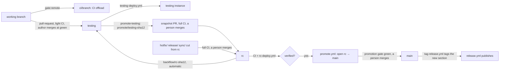

# Branches, gates, and promotions

How a change reaches this repository, and what refuses it on the way. The
enforcement is real code — `.github/workflows/flow.yml`,
`scripts/flow-guard.mjs`, `scripts/hooks/pre-push` — so this page describes
machinery rather than manners; when the two disagree, the machinery is what
happened and this page is a bug.

Three long-lived branches, one chain: everything on `main` is on `rc`, and
everything on `rc` is on `testing`. **Pull requests target `testing`.** `rc`
takes a frozen snapshot of `testing`, and `main` takes `rc`.

| Branch | What it is | How it moves |
| :--- | :--- | :--- |
| `testing` | The integration lane. Every feature pull request targets it; light CI; every push deploys the [testing instance](./TESTING-INSTANCE.md). | Merging pull requests (merge commits) — the author merges at green — and the back-flow from `rc`. Never rewritten or deleted. |
| `rc` | The release candidate, and the staging environment (`rc-deploy.yml`). | Merging the lanes into rc (merge commits, a person merges): a `promote/*` snapshot of `testing`, or a `hotfix/`, `release/` or `sync/` branch cut from `rc`. Full CI. |
| `main` | The release trunk. Stable tags are cut here. | One way only: the promotion merge of `rc` into `main`, after `rc` is deployed and verified. |

The short-lived branches the machinery itself reads by name:

| Branch | Made by | What it is |
| :--- | :--- | :--- |
| `ci/<branch>`, `ci/full/<branch>` | `bun run gate:remote` | an offload: `ci.yml` on a push, no pull request (`CI offload`). Never merged anywhere. |
| `promote/testing-<sha12>` | `promote-testing.yml` (dispatch with `open`), or by hand | a snapshot of `testing`'s tip that never moves — the head of a testing → rc pull request |
| `backflow/rc-<sha12>` | `promote-testing.yml`, automatically | `rc`'s tip, cut whenever `rc` has commits `testing` lacks — the head of the `sync: rc → testing` pull request |
| `hotfix/*`, `release/*`, `sync/*` | a person (`release/roll` by `promote.yml`) | cut from `origin/rc`, into `rc`: a fix rc needs now, the changelog roll, a sync of main |

Everything else — `wt/*`, `agent/*`, `talaria/*`, a fork's branch — is a
working branch, and this policy has no opinion about it until it opens a pull
request.

## How a change reaches main



1. **Before a pull request exists, CI is the compile.** `bun run gate:remote`
   pushes `HEAD` to `ci/<branch>` and reports the first red job with its log;
   locally an author runs `bun run check` and cheap targeted tests only.
2. **Open the pull request against `testing`.** Not `rc` and not `main`:
   `flow.yml`'s `pr-target` refuses a feature into either, and says to
   retarget (`gh pr edit <n> --base testing`).
3. **Its checks run light** — the surfaces the diff touched, Linux only (the
   [CI modes](#ci-modes) below). `scripts/hooks/pr-watch.mjs` watches them.
4. **The author merges it at green** — `gh pr merge <n> --merge --admin` once
   pr-watch is green. `--admin` bypasses the review rule (`testing-review`),
   never the checks (`testing-checks` has no bypass). See [Who merges](#who-merges).
5. **testing deploys it.** The push runs `ci.yml` in integration mode and
   `testing-deploy.yml`, which publishes `ghcr.io/outcrop-labs/talaria:testing`;
   the VM follows. `node scripts/hooks/testing-watch.mjs <n>` says when the
   merge is live — then exercise it there ([TESTING-INSTANCE.md](./TESTING-INSTANCE.md),
   "Agent access").
6. **A snapshot is promoted into `rc`.** On demand,
   `gh workflow run promote-testing.yml --ref main -f open=true` cuts
   `promote/testing-<sha12>` at testing's tip and opens its pull request into
   `rc`: full CI (macOS, Windows, iOS, e2e), an approving review, a person
   merges. The snapshot never moves, so the battery runs once per candidate.
7. **`rc-deploy.yml` deploys `rc`.** Every push to `rc` builds the commit's
   api package and app image, boots it as a fresh instance, and checks it —
   `scripts/deploy-smoke.mjs` is the list: `/api/healthz` ok, the SPA shell
   serving, the Rust api answering, the version reported matching the commit
   built. This is what "deployed in RC" means; it is a rehearsal of the release
   pipeline, not a release (no channel tag moves).
8. **`promote.yml` offers the roll, then the promotion.** When rc's tip is
   verified (CI and `rc-deploy` green, in runs made on `rc`), the changelog
   roll comes first (a `release/roll` pull request into `rc`), then
   `promote: rc → main`. See [Promoting](#promoting).
9. **The promotion gate re-checks the evidence** on that pull request —
   `flow.yml`'s `promotion-gate` reads the Actions API and requires a green CI
   run *and* a green `rc-deploy` run for the head commit, made on `rc`, and no
   unrolled `changelog/` entries. It waits for both runs rather than failing
   ahead of its own evidence: a failed required check is never re-evaluated.
   The pull request's own CI runs in [promotion mode](#ci-modes): its merge
   tree is rc's tip, so the battery is not run a second time on it.
10. **A person merges it**, as a merge commit, and the release follows:
    `tag-release.yml` tags `main` `vX.Y.Z` when the promotion lands a section
    no tag names yet, and `release.yml` does the rest
    ([RELEASING.md](../RELEASING.md)).
11. **The back-flow closes the loop.** Whenever `rc` gains commits `testing`
    lacks (the roll, a hotfix, a sync), `promote-testing.yml` opens
    `sync: rc → testing` from `backflow/rc-<sha12>`. See [Back-flow](#back-flow).

Nothing in that flow is a judgement call but the merges, and no step is skipped
by aiming somewhere else: `main` has one door (the promotion), `rc` has four
(a snapshot and the three lanes cut from it), and each refuses anything else.

## The lanes into rc

`rc` moves only by these, each a pull request a person merges, each checked by
`pr-target` from the commits themselves (`flow.yml` fetches both sides):

- **`promote/*` — a snapshot of `testing`.** Refused unless the head commit is
  on `origin/testing` *and* `git merge-tree --write-tree <rc> <snapshot>`
  writes the snapshot's own tree — that is, rc holds nothing testing lacks. A
  hotfix or a roll that landed on rc without its back-flow turns the snapshot
  red until the back-flow merges and a fresh snapshot is cut. `testing` itself
  is refused as a head: a moving head restarts the full battery and dismisses
  the approval on every merge into testing.
- **`hotfix/*` — a fix rc needs now.** Cut from `origin/rc`, never from
  testing: `pr-target` refuses a head carrying any commit `testing` already
  has. **A hotfix adds no migrations** (`migrations (replay + upgrade)` and
  judge-pr's `hotfix-adds-migration` both refuse one — see
  [Migrations](#migrations)). Then the back-flow carries it into testing.
- **`release/*` — the changelog roll.** `promote.yml` opens `release/roll`
  against rc when a verified tip carries `changelog/` entries; by hand it is
  `release/roll-<version>` cut from `origin/rc`.
- **`sync/*` — trunk content into rc**, cut from `origin/rc` with `main`
  merged in.

Every lane is same-repository only: a fork's branch called `promote/x` or
`hotfix/x` is not that lane. Anything else into `rc` gets the retarget message.

## Back-flow

`testing ⊇ rc` has to hold for the next snapshot to pass, and `rc` gains
content of its own three ways: the roll, a hotfix, a sync of main. So on every
CI completion on `rc`, `promote-testing.yml` checks whether `rc` has commits
`testing` lacks and, if so, cuts `backflow/rc-<sha12>` at rc's tip and opens
`sync: rc → testing`. Light CI, and the author or an admin merges it like any
pull request into testing.

The head is never `rc` itself: a protected branch cannot carry a conflict
resolution. A conflict is resolved on the back-flow branch —
`git switch backflow/rc-<sha12> && git merge origin/testing`, resolve, push —
which is pr-watch's ordinary advice for any pull request behind testing.

On `rc`, `flow-guard` holds the other half after the merge: a merge whose
second parent is on `testing` (a snapshot's) must carry exactly that parent's
tree. A hotfix that slipped in between the snapshot's check and its merge
leaves a tree that is neither branch's, and the `rc` push goes red naming the
back-flow.

## Changelog travel

Entries ride their feature: `changelog/YYYY-MM-DD-<slug>.md` lands in
`testing` with the change, and reaches `rc` with the snapshot. The roll
happens on `rc` after a promotion — it folds the entries into a
`CHANGELOG.md` section and deletes the files — and flows back to `testing`.
Once an entry is on `rc` the roll owns it, so judge-pr raises a `must`
(`changelog-entry-rewritten`) on a pull request into testing that edits or
deletes it: the back-flow would conflict. Add a new entry instead.

## Migrations

`MIGRATIONS` in `ui/src/server/db/pg.ts` is append-only on every long-lived
branch, and an entry's array index is its identity: a changed applied index
refuses boot. So:

- **testing defines the order.** Features land there first; a snapshot carries
  the array to rc unchanged.
- **The upgrade baseline is the pull request's base**: `migrations (replay +
  upgrade)` replays the array from zero and upgrades the base branch's array —
  testing for a feature, rc for a snapshot or a lane — with the schema
  snapshot undrifted.
- **A `hotfix/*` head appends nothing.** Its statement would land at one index
  on rc and another on testing, whose array is ahead. Land the migration
  through testing.
- **The testing database is disposable.** A migration edited after the testing
  instance applied it stops that boot; [TESTING-INSTANCE.md](./TESTING-INSTANCE.md)
  has the reset runbook.

## CI modes

`scripts/surfaces.mjs` chooses the mode; job `name:`s never change with it, so
the required checks match in every mode. A missing or unknown mode counts as
full, and a missing surface counts as on. A pull request is planned by its
base's copy of the planner, so a mode reaches a branch's pull requests once the
planner is on that branch: the promotion that carries promotion mode to `main`
still runs full, and the ones after it do not.

| Mode | When | What runs |
| :--- | :--- | :--- |
| light | a pull request into `testing` (or a stacked branch); a push to `ci/<branch>` | the surfaces the diff touched, Linux only. The api: fmt, workspace clippy, `cargo test -p` for the touched crates and the live tests they reach. No macOS, Windows, iOS or e2e. |
| integration | a push to `testing` | every touched Linux surface since testing's last green push run; the api workspace-wide with every live test |
| full | a pull request into `rc`, or into `main` when promotion mode does not take it; a push to `rc` or `main` (since the last green run); `ci/full/<branch>` and an offload of a `hotfix/`, `release/`, `sync/`, `promote/` or `backflow/` branch; `release.yml`; the daily full battery of testing | every touched surface, including macOS, Windows, iOS and e2e |
| promotion | the `rc → main` pull request, when its head is this repository's `rc` and the merge ref's tree equals rc's tip tree | `what changed` and `invariants (no deps)` only; every surface job skips. The tree is the one rc's push CI checked and `rc-deploy` deployed, and the promotion gate requires exactly those runs. A fork's `rc`, or a merge tree that differs, runs full and the run's summary says why |

A push to a long-lived branch checks everything since that branch's last green
push run (falling back to the merge-base with the branch below it), and those
pushes queue rather than cancel — so no commit on `testing`, `rc` or `main` goes
unchecked, and a burst of merges is covered by the run that finishes.

## What each gate proves

| Gate | Runs | Proves |
| :--- | :--- | :--- |
| `bun run check` | locally, every time | invariants (including this file's own anchors) + every doc link resolves + generated references are not drifted |
| `bun run gate:remote` | before a pull request exists, in the background | `ci.yml` on a `ci/<branch>` push (`CI offload`): light, or every platform with `--full` — the same jobs a pull request gets |
| `ci.yml`, light | pull requests into `testing` | the touched surfaces build and test on Linux — enough to land in the lane |
| `ci.yml`, integration | every push to `testing` | the lane as merged: everything since its last green run, the api workspace-wide |
| `ci.yml`, full | pull requests into `rc` (and into `main` when not a promotion), pushes to `rc`/`main`, every publish | every surface on every platform — the battery a release carries |
| `ci.yml`, promotion | the `rc → main` pull request whose merge tree is rc's tip | nothing new, on purpose: the tree is byte for byte rc's, so the evidence is rc's push CI and `rc-deploy`, which `promotion-gate` requires. Only `what changed` and the invariants run |
| `app image builds (docker)` (ci.yml) | changes to the image's build context (`Dockerfile`, `.dockerignore`, `docker/`, `ui/`, `cli/`, `mcp/`, `omp-auth/`, `apps/`, the SDK schema, the shipped skills, the chassis template), in every mode but promotion | the app image builds from the context `.dockerignore` leaves, as `rc-deploy` and `release.yml` build it — on the pull request, not after the merge. Every `rc-deploy` failure from Sep 29 to Nov 10 was this build. Against main's published api package: it proves the context, not this commit's api |
| daily full battery (`promote-testing.yml`) | weekdays, on testing's tip | macOS, Windows, iOS and e2e on the lane, which no testing push runs; red opens the `testing-red` issue. Never promotion evidence |
| `migrations (replay + upgrade)` (ci.yml) | migration-touching changes | the array replays from zero *and* upgrades the base branch's array, with the schema snapshot undrifted; a `hotfix/*` appends nothing |
| `testing-deploy.yml` | every push to `testing` | the commit's dev-profile image boots and answers, and becomes `:testing`; the VM follows. Not a required check: a red deploy blocks no merge, and testing-watch reports it |
| `rc-deploy.yml` | every push to `rc` | the commit's own image boots as a fresh instance and answers — the staging deploy |
| `pr-target` (flow.yml) | pull requests into `main`, `rc`, `testing` | `main` takes only this repository's `rc`; `rc` takes only the lanes, checked from the commits; no title or body that would skip the merge's own push checks; no retarget into `rc` or `main` until a push re-runs the checks |
| `promotion-gate` (flow.yml) | the promotion pull request | the commit was verified in `rc` (CI green, deploy green, in runs made on `rc`) and carries no unrolled `changelog/` entries |
| `judge.yml` | every pull request | the exact rules (branch flow, changelog entry for user-visible paths, do-not-touch trees, PR-body asks), from the trusted branch's copy; one sticky comment from a job with no checkout; red on a deterministic `must` only |
| `judge-review.yml` | same-repository non-draft pull requests; `ci/**` pushes as `offload / judge (review)` | a model's review (OpenRouter; model pinned in `scripts/judge-review.mjs`) run from the trusted branch: at most 3 line annotations, one sticky comment only when there is one to read, cost in the summary. Never fails, never approves, never required |
| `branch-push` (flow.yml) | pushes to `main`, `rc`, `testing` | content provenance: what a push introduces came from where it is allowed to come from |
| `pre-push` (git hook) | a push from a wired clone | the same provenance rule, before the network |
| `mobile-package.yml` | pull requests touching `mobile/`, pushes to rc/main, and on demand | a debug-signed Android APK attached to the run — an `adb install` artifact, not distributable |
| `release.yml` | tags, and 03:17 UTC | the published channel images and the GitHub Release; a tag whose commit is not on `main` (stable) or `rc` (`-rc.N`) publishes nothing |

## Promoting

Two promotions, both pull requests a person merges, both from a head that does
not move while it is checked.

**testing → rc, by snapshot.** `promote-testing.yml` keeps the lane: dispatched
from main with `open`, it cuts `promote/testing-<sha12>` at testing's tip and
opens the pull request into `rc` (closing an older open snapshot as
superseded); its weekday run writes a readiness summary — what testing has over
rc, its CI and deploy runs, the changelog leads. When rc moves under an open
snapshot, it rewrites the body's `rc @` line, and that `edited` event re-runs
`pr-target` against the rc it would now merge into. By hand:

```bash
git fetch origin testing
git push origin origin/testing:refs/heads/promote/testing-$(git rev-parse --short=12 origin/testing)
gh pr create --base rc --head promote/testing-<sha12> --title "promote: testing → rc"
```

**rc → main.** `promote.yml` does the offering. Two of its steps are things a
person would otherwise have to remember:

1. **It fires when either half of the evidence finishes, and offers only when both are
   green.** `ci.yml` and `rc-deploy.yml` both start on a push to `rc` and neither is guaranteed
   to finish first; with one green and one still running, the run says so and waits for the
   other.
2. **It writes the evidence where you will read it**: the run's summary carries the tip, the CI
   and deploy run links, and the commits since `main`'s tip. Then the token decides the shape:
   - **`PROMOTION_TOKEN` set** — a fine-grained PAT (or GitHub App installation token) with
     `contents: write` and `pull-requests: write`, a repository secret. While `changelog/`
     holds entries, the workflow opens (or refreshes) the changelog roll's pull request
     against `rc` instead, and the promotion waits for it (RELEASING.md, "Promoting to
     stable"). Then it opens (or refreshes) the `rc → main` pull request and arms
     auto-merge, but only when `main`'s required checks actually name
     `promotion gate (rc verified)`.
   - **No token** — GitHub starts no workflows for events caused by `GITHUB_TOKEN`, so a pull
     request the workflow opened would never have its checks report. The workflow stops at
     the summary and prints the exact command; the pull request you open runs every check.

`promote-testing.yml` uses the same `PROMOTION_TOKEN` to open and edit the
snapshot and back-flow pull requests (the branches themselves are made with its
own `GITHUB_TOKEN`), and prints the commands when it is absent.

Decisions that shape this, stated because they are policy rather than accident:

- **Conflicts are the author's.** No branch is rebased by machinery. A feature
  behind testing is brought up to date by whoever owns it; a back-flow conflict
  is resolved on its `backflow/*` branch.
- **A promotion adds no content.** Both promotion merges must carry the tree of
  the branch they merged, and `flow-guard` refuses one that does not on the push
  — so a hand-resolved conflict cannot ride into `rc` or `main` unreviewed.
- **No "Update branch" click.** `strict` is off everywhere (see the recipe below):
  a pull request's checks run against GitHub's merge commit either way, and on
  `main` an up-to-date requirement would block every promotion after the first.

## Who merges

| Into | Who | How |
| :--- | :--- | :--- |
| `testing` | the author, once pr-watch is green | `gh pr merge <n> --merge --admin`. An agent on the host does this with the owner's credentials. `--admin` bypasses `testing-review`, never `testing-checks`: a merge while a required check is pending or red is refused. A pull request the Talaria App or a bot opened waits for an approving review. |
| `rc` | a person, after an approving review | the snapshot, a hotfix, the roll, a sync — merge commit only, under rc's classic protection (below). |
| `main` | a person (or auto-merge, where `PROMOTION_TOKEN` opened it and the gate is required) | the promotion of `rc`, merge commit only |

Deliberately never `GITHUB_TOKEN` for a merge into `rc` or `main`: a merge made
with it starts nothing — not `ci.yml`, not the push guard, not the image feeds.

## The required settings

The guards in the repo are tripwires: they report, and somebody acts. What
*stops* a push is GitHub's branch protection and rulesets, and those live in the
repository, not in this tree — they are the one part of this model a commit
cannot enforce. Apply them once (an admin), and again if one is ever edited.

**`rc` and `main` keep their classic branch protection, unchanged.** The testing
lane adds rules for `testing` only. As set today (read back with
`gh api repos/outcrop-labs/talaria/branches/<branch>/protection`):

| | `rc` | `main` |
| :--- | :--- | :--- |
| Required checks (`strict` off) | `what changed`, `invariants (no deps)`, `test + typecheck (ui)`, `typecheck + build (mcp)`, `typecheck + test (cli)`, `fmt + clippy + test (api)`, `fmt + clippy + test + typecheck (desktop)`, `clippy + test + connect smoke (desktop windows)`, `clippy + test + connect smoke (desktop macos)` | none |
| Approvals | 1 from any reviewer; stale approvals dismissed; conversations resolved | 1 from any reviewer |
| Admins | may bypass (`enforce_admins` off) | may bypass (`enforce_admins` off) |

`pr target (flow)` and `promotion gate (rc verified)` run and report on every
pull request into `rc` and `main`, but neither is required there: a red one is
the merging person's stop sign, as it is today. Adding a context to either list
is the owner's call, one call per context:

```bash
gh api -X POST repos/outcrop-labs/talaria/branches/rc/protection/required_status_checks/contexts -f 'contexts[]=pr target (flow)'
```

Repository-wide, first: merge commits only.

```bash
gh api -X PATCH repos/outcrop-labs/talaria -F allow_rebase_merge=false -F allow_squash_merge=false -F allow_merge_commit=true
```

The integrity ruleset `talaria-production`: no deletion and no force-push on any
of the three, and no bypass. It adds nothing on `rc` that its classic
protection does not already forbid; on `testing` it is the only thing that does.

```bash
gh api -X PUT repos/outcrop-labs/talaria/rulesets/21662214 --input - <<'EOF'
{"name":"talaria-production","target":"branch","enforcement":"active","conditions":{"ref_name":{"include":["~DEFAULT_BRANCH","refs/heads/rc","refs/heads/testing"],"exclude":[]}},"bypass_actors":[],"rules":[{"type":"deletion"},{"type":"non_fast_forward"}]}
EOF
```

`testing-checks` — the light lane's checks. Nobody bypasses them.

```bash
gh api -X POST repos/outcrop-labs/talaria/rulesets --input - <<'EOF'
{"name":"testing-checks","target":"branch","enforcement":"active","conditions":{"ref_name":{"include":["refs/heads/testing"],"exclude":[]}},"bypass_actors":[],"rules":[{"type":"required_status_checks","parameters":{"strict_required_status_checks_policy":false,"do_not_enforce_on_create":false,"required_status_checks":[{"context":"what changed","integration_id":15368},{"context":"invariants (no deps)","integration_id":15368},{"context":"test + typecheck (ui)","integration_id":15368},{"context":"typecheck + build (mcp)","integration_id":15368},{"context":"typecheck + test (cli)","integration_id":15368},{"context":"fmt + clippy + test (api)","integration_id":15368},{"context":"fmt + clippy + test + typecheck (desktop)","integration_id":15368},{"context":"test + assemble (mobile)","integration_id":15368},{"context":"migrations (replay + upgrade)","integration_id":15368},{"context":"app image builds (docker)","integration_id":15368},{"context":"pr target (flow)","integration_id":15368}]}}]}
EOF
```

`testing-review` — one approving review from anyone with write access, which
binds the Talaria App and any bot. Admins bypass it, so the author merges at
green with `--admin`; the checks above still bind them.

```bash
gh api -X POST repos/outcrop-labs/talaria/rulesets --input - <<'EOF'
{"name":"testing-review","target":"branch","enforcement":"active","conditions":{"ref_name":{"include":["refs/heads/testing"],"exclude":[]}},"bypass_actors":[{"actor_id":5,"actor_type":"RepositoryRole","bypass_mode":"always"}],"rules":[{"type":"pull_request","parameters":{"required_approving_review_count":1,"dismiss_stale_reviews_on_push":true,"require_code_owner_review":false,"require_last_push_approval":false,"required_review_thread_resolution":false,"allowed_merge_methods":["merge"]}}]}
EOF
```

Check them with `gh api repos/outcrop-labs/talaria/rules/branches/testing`.

And the deployment environment `testing`, deployable only from `testing`, with
no reviewers (testing-deploy's verify job runs in it):

```bash
gh api -X PUT repos/outcrop-labs/talaria/environments/testing --input - <<<'{"deployment_branch_policy":{"protected_branches":false,"custom_branch_policies":true}}'
gh api -X POST repos/outcrop-labs/talaria/environments/testing/deployment-branch-policies -f name=testing -f type=branch
```

Things about those lists that are easy to get wrong:

- **A required check has to be able to REPORT on the pull request it guards.**
  flow.yml's `branch-push` job is triggered by a push, so it is on no list: it
  would sit "pending" on every pull request. Its work still happens on the push
  that follows the merge, where a red run names the commit.
- **Every listed job skips per *job*, never per workflow.** A job skipped by a
  job-level `if` reports success; a workflow that never starts (a `paths:`
  filter) reports nothing, which a ruleset reads as pending for ever. That is
  why `migrations (replay + upgrade)` and the platform jobs are `ci.yml` jobs.
- **`testing-checks` binds admins; rc's and main's protection does not.** An
  author merging into testing with `--admin` skips the review and nothing else.
  On `rc` and `main` an admin can still merge past a red or pending check, as
  today — the full battery and the promotion gate report there, and the person
  merging reads them.
- **`strict` is off everywhere**, for two reasons. A pull request's checks run
  against GitHub's merge commit either way, so an up-to-date base only adds
  churn; and after a promotion, main's tip is a merge commit rc does not
  contain, so `strict` on main would block every later promotion.
- **`PROMOTION_TOKEN` decides whether the workflows can open pull requests at
  all.** Without it, `promote.yml` and `promote-testing.yml` print the commands
  instead. With it, turn on **Allow auto-merge** (Settings → General) if the
  promotion should merge itself; auto-merge is armed only when main's required
  checks name `promotion gate (rc verified)` — today they name nothing, so a
  person merges every promotion.
- **Neither judge is on any list.** `judge (standards)` fails only on a
  deterministic `must`. `judge (review)` never fails; with
  `JUDGE_REVIEW_GATE=blockers`, pr-watch holds an agent's done on an
  unanswered, high-confidence blocker — never a person's merge. The
  testing-review approval stays a person's: the judges post comments, never
  reviews, and Actions may not approve pull requests.
- **A new context joins a ruleset only once its branch reports it.** A required
  context that the branch's own `ci.yml` never reports holds every pull request
  into it pending for ever. So `app image builds (docker)`, in the
  `testing-checks` list above, is appended to that ruleset after the change that
  adds it merges into testing.

## What the guard can see, and what it cannot

`scripts/flow-guard.mjs` is one implementation with two wirings (`flow.yml`
server-side, `scripts/hooks/pre-push` locally), and its rules are about CONTENT
PROVENANCE rather than identity — a branch tip says nothing about who pushed it,
and no client-side check can ask. What it reads is where the commits came from:

- **`main`**: every commit a push introduces that is not a merge commit must
  already be reachable from `rc`, AND a merge's tree must equal the tree of the
  branch it merged (`after^2`) — main takes `rc` whole. A direct push, a squash
  merge, a rebase merge and a hand-made merge with an edit smuggled inside all
  fail; a fast-forward of `main` to `rc`'s tip passes.
- **`rc`**: the tip must be a merge commit, or every introduced commit must
  already be reachable from `main` (a sync of the trunk). A merge whose second
  parent is on `testing` must carry that parent's tree — rc takes testing whole,
  the same claim main makes of rc. This rule cannot see INSIDE a hotfix's merge
  — a local merge that adds a file is indistinguishable from a reviewed one —
  which is why rc's protection requires a pull request.
- **`testing`**: the tip must be a merge commit, or every introduced commit must
  already be reachable from `rc` or `main` — a fast-forward to content those
  branches already verified (how the lane was first brought up to `rc`).
- **None** may be rewritten or deleted by a push.

Pull requests are judged too (`pr-target`). Into any of the three, a title or body
carrying `[skip ci]`, `[ci skip]`, `[no ci]`, `[skip actions]`, `[actions skip]` or a
`skip-checks: true` trailer is refused: the merge commit carries both, so the branch
would move with no push checks run on it. Into `rc` or `main`, a pull request retargeted
from another base is refused until a push re-runs its checks, because CI does not re-run
on a base change and the checks it has were run in the old base's mode. Into `main`,
the head must be this repository's `rc`. Into `rc`, the head must be one of [the
lanes](#the-lanes-into-rc), from this repository, and pass its commit rule — `pr-target`
fetches `testing`, `rc`, `main` and the pull request's head to check it, and judges
against rc's tip as fetched, not the event's possibly stale base.

The same text in an ordinary commit message skips that commit's own push runs — the
`ci/<branch>` offload included — and GitHub matches it anywhere in the message, so a
commit *about* these markers has to describe them rather than quote them.

Each job reads the policy from a revision the change cannot edit — for a pull request,
the base's tip; for a push, the tip being moved. So the change that alters the policy is
judged by the policy before it: the cutover's own pull request into `rc` passes under
rc's old rules, and binds the pull requests after it.

The guard fails closed on an unknown — an unresolvable base (including the tip a
force-push discarded), a missing `origin/testing`, a shallow clone — rather than passing
because it could not tell.

## The cutover (once)

How `rc`-takes-everything became testing-first, kept for the record and for a fork
doing the same. The order matters:

0. **Freeze merges into `rc`** — nothing but the cutover's own pull request — until
   step 3 is done, so rc cannot get ahead of testing in the window.
1. **Merge the cutover into `rc`** (merge commit). Its `pr target (flow)` runs rc's
   old policy, so it passes.
2. **Fast-forward `testing` to `rc`** — no force, no re-creation, from a checkout whose
   working tree has the new flow-guard (the pre-push hook judges with it):
   `git fetch origin && git push origin origin/rc:refs/heads/testing`. Watch
   `branch push (flow)` go green, CI run in integration mode, and `testing-deploy`
   publish `:testing`. This has to happen before step 4: `testing-checks` would refuse
   a direct push.
3. **Retarget the open feature pull requests** to testing, then lift the freeze:
   `gh pr list --base rc --state open --json number,headRefName --jq '.[] | select(.headRefName | test("^(hotfix|release|sync|promote)/") | not) | .number' | xargs -r -n1 gh pr edit --base testing`
4. **Apply the testing rulesets** above (`talaria-production` widened,
   `testing-checks`, `testing-review`) and create the `testing` environment. rc's
   and main's classic protection stays as it is.
5. **Set each instance's workbench repo flow base** for this repository to `testing`.
6. **Confirm the machinery**: `gh workflow run promote-testing.yml --ref main` prints a
   readiness summary; on a throwaway pull request into testing,
   `gh pr merge --merge --admin` is refused while a required check is pending and
   allowed once it is green; the same pull request retargeted to `rc` goes red in
   `pr target (flow)` with the retarget message.

## If a promotion is wedged

- **A snapshot's `pr target (flow)` is red with "rc has content testing lacks".** A
  hotfix, a roll or a sync reached rc after the snapshot was cut. Merge the open
  `sync: rc → testing` back-flow (dispatch `promote-testing.yml` if there is none), then
  open a fresh snapshot — this one is closed as superseded.
- **No `rc → main` pull request appeared.** The `promote.yml` run's summary says which:
  "not ready to promote" (one of the two runs is red or still going — a red one needs a
  fix, and a new push re-runs both), or "no pull request was opened for you" (no
  `PROMOTION_TOKEN` — open it from the compare link and merge it). If `rc-deploy.yml` is
  red and the commit is fine, re-run that run or dispatch the workflow from `rc`; the gate
  reads runs by commit, so either clears it.
- **A pull request sits at "Expected — Waiting for status to be reported".** That is the
  `GITHUB_TOKEN` rule: a pull request opened by a workflow with the repository token
  starts no workflows, so its checks never report. Close it and open one yourself, or add
  the `PROMOTION_TOKEN` secret.
- **Auto-merge never fired.** Its log says which case it hit: the required checks could
  not be read, main's required checks do not include `promotion gate (rc verified)` (today
  they include nothing), or the API refused to arm it. All three are merge-by-hand plus a settings fix.
- **The gate reports no green run for a commit that otherwise looks green.** It reads runs
  by commit, so the run has to be of that exact commit: a re-run of `rc-deploy` (or a
  dispatch of it from `rc`) verifies the same tree; a re-run of a pull request's checks is
  not a run of `rc-deploy` at all.
